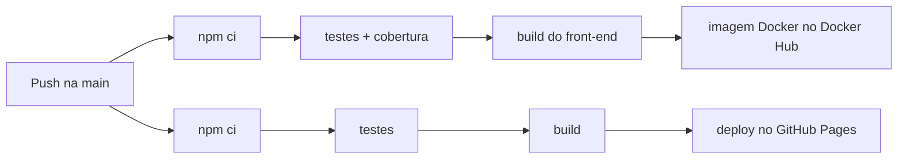

# La Farina

Projeto desenvolvido como solução web para gestão de pedidos de pizzaria, com front-end em Vue 3 e API simulada em JSON Server.

## Demonstração

* Aplicação web: https://hebermacedo.github.io/La-Farina/#/menu
* API: https://api-tpizza-artesanal.onrender.com (publicada a partir do repositório [banco-json](https://github.com/HeberMacedo/banco-json), com o mesmo servidor de `server/server.js`)
* Saúde e métricas da API: [/health](https://api-tpizza-artesanal.onrender.com/health) e [/metrics](https://api-tpizza-artesanal.onrender.com/metrics)

O site é publicado automaticamente no GitHub Pages pelo pipeline, só depois que todos os testes passam. A API é publicada no Render a cada push no repositório `banco-json`.

### Contas de teste

| Perfil | E-mail | Senha |
|---|---|---|
| Administrador | admin@tpizza.com | admin123 |
| Cliente | marina@teste.com | 123456 |
| Cliente | heber@teste.com | 123456 |

> A API online roda no plano gratuito do Render, que não tem disco persistente: quando o serviço reinicia, o banco volta ao estado original. Contas e pedidos criados pelo site somem nesse momento, mas as contas acima sempre existem.

## Tecnologias

* Vue 3
* Vue Router
* JSON Server
* Docker
* GitHub Actions
* Jest + Supertest (testes)
* Prometheus + Grafana (observabilidade)

## Como executar localmente

```bash
npm install
npm run bancojson   # API em http://localhost:3000
npm run serve       # site em http://localhost:8080 (em outro terminal)
```

Com Docker (seção abaixo) as portas são as mesmas: API em `http://localhost:3000` e site em `http://localhost:8080`.

## Docker

```bash
docker compose up -d --build
```

Para limpar o volume local:

```bash
docker compose down -v
```

Para subir também o Prometheus e o Grafana, veja a seção [Observabilidade](#observabilidade).

## Estrutura do projeto

```markdown
├── .github/workflows/
│   ├── ci.yml             # Testes com cobertura, build e publicação da imagem no Docker Hub
│   └── pages.yml          # Testes, build e deploy do site no GitHub Pages
├── db/
│   └── db.json            # Banco de dados da API (cardápio, usuários e pedidos)
├── observabilidade/
│   ├── prometheus.yml     # Coleta das métricas da API a cada 5 s
│   ├── alertas.yml        # Regras de alerta (API fora do ar, taxa de erro, lentidão, recusas)
│   └── grafana/           # Fonte de dados e painel "La Farina — API"
├── postman/               # Coleção do Postman com as rotas da API
├── public/
│   ├── img/               # Recursos visuais (Banner, Logo Circular e Ícones)
│   └── index.html         # Template HTML principal injetado pelo Webpack
├── scripts/
│   ├── gerar-trafego.js   # Gera tráfego na API para a demonstração de observabilidade
│   └── resumo-cobertura.js # Escreve a tabela de cobertura no resumo do GitHub Actions
├── server/
│   ├── server.js          # API: JSON Server com validações, /health e /metrics
│   └── observabilidade.js # Logs em JSON, métricas no formato Prometheus e trace id
├── src/
│   ├── components/        # Componentes reutilizáveis (NavBar, Banner, Alerta, Pedido)
│   ├── services/          # Chamadas à API, login, pedidos e regras (frete, sabores)
│   ├── views/             # Telas principais mapeadas pelas rotas da aplicação
│   ├── router/            # Configurações de navegação SPA (Single Page Application)
│   ├── App.vue            # Componente raiz da aplicação
│   └── main.js            # Inicialização e montagem do ecossistema Vue
├── tests/                 # 75 testes automatizados (Jest + Supertest)
├── Dockerfile             # Imagens do site (Nginx) e da API (estágio "api")
├── docker-compose.yml     # Site, API e, no perfil "observabilidade", Prometheus e Grafana
├── vue.config.js          # Configurações globais de compilação do Vue CLI
└── package.json           # Dependências e scripts de automação do projeto
```

## Sobre o Projeto

### Objetivo da solução
O projeto é uma solução web para gestão de pedidos de pizzaria, com foco em oferecer uma experiência de compra e acompanhamento de pedidos em tempo real. A interface em Vue 3 consulta e atualiza um banco de dados REST simulado em JSON Server, mantendo as operações de menu, cadastro, login, pedidos e acompanhamento em um fluxo de uso simples e direto.

### Escopo
O sistema atual cobre:
- consulta do cardápio e tipos de pizza;
- cadastro e autenticação de usuários;
- criação, listagem, atualização e remoção de pedidos;
- pedidos com várias pizzas, cada uma com tamanho, 1 ou 2 sabores (meio a meio) e borda;
- entrega grátis quando o subtotal passa de R$ 80,00;
- painel administrativo para acompanhamento do status dos pedidos;
- validação client-side antes do envio de pedido e cadastro.

O sistema não pretende ser um backend completo de produção com autenticação em JWT, banco relacional ou filas de processamento. A API tem uma camada básica de observabilidade (logs estruturados, métricas e health check), descrita na seção [Observabilidade](#observabilidade). O escopo principal é demonstrar o fluxo do negócio de pizzaria em uma aplicação front-end conectada a uma API de mock/rest.

### Tipos de teste aplicados

São 75 testes automatizados em 5 arquivos, com cerca de 92% das linhas cobertas.

| Arquivo | Tipo | Testes | O que valida |
|---|---|---|---|
| `tests/api.test.js` | Integração (API) | 23 | Status HTTP e corpo de todas as rotas, fluxos de sucesso e de erro |
| `tests/observabilidade.test.js` | Integração (API) | 22 | `/health`, `/metrics`, trace id, logs estruturados e tratamento de erros |
| `tests/servicosFront.test.js` | Unidade (front-end) | 16 | Cliente HTTP, login, cadastro e chamadas de pedidos com a API simulada |
| `tests/itensPedido.test.js` | Unidade (regra de negócio) | 10 | Várias pizzas, 1 ou 2 sabores, soma de valores |
| `tests/entrega.test.js` | Unidade (regra de negócio) | 4 | Taxa de R$ 8,00 e frete grátis acima de R$ 80,00 |

- Os testes de API usam Jest + Supertest em um banco temporário copiado de `db/db.json`, sem alterar o banco real do projeto.
- Os testes do front-end trocam o `fetch` e o `localStorage` por versões falsas, então rodam sem rede e sem navegador.
- Build de front-end: `npm run build` garante que o Vue compila corretamente.

### Pipeline de entrega

Dois workflows rodam a cada push ou pull request na `main`:



- `.github/workflows/ci.yml`: roda os testes com cobertura, publica o resumo da cobertura na página da execução, guarda o relatório HTML como artefato, gera o build e, só na `main`, publica a imagem no Docker Hub.
- `.github/workflows/pages.yml`: roda os testes e só publica o site no GitHub Pages se todos passarem.
- Em pull requests, os dois workflows testam e compilam, mas não publicam nada.

## Cenários para teste

| Item | Descrição |
|---|---|
| **Caso de Uso** | UC1 - Realizar pedido de pizza |
| **Finalidade** | Permitir que o cliente escolha um item do cardápio, personalize o pedido e envie a solicitação para o sistema de produção. |
| **Atores** | Cliente, Sistema |
| **Pré-condições** | O cliente acessou a tela de menu e a API da pizzaria está disponível. |
| **Fluxo Principal** | 1- **Sistema** carrega o menu com as opções de pizzas disponíveis. <br> 2- **Cliente** seleciona a pizza, tamanho, 1 ou 2 sabores (meio a meio), borda e acompanhamentos desejados, podendo adicionar outras pizzas ao mesmo pedido. <br> 3- **Cliente** preenche os dados obrigatórios, como nome e informações do pedido. <br> 4- **Sistema** valida os campos e confirma que os dados estão completos. <br> 5- **Cliente** envia o pedido. <br> 6- **Sistema** registra a solicitação e a exibe no painel de monitoramento. |
| **Fluxos Alternativos** | FA1 - Campos obrigatórios vazios [Passo 4 do Fluxo Principal]. <br> 1- **Sistema** exibe mensagem de alerta destacando os campos faltantes. <br> 2- **Sistema** mantém a tela aberta para correção. <br> FA2 - API indisponível [Passo 5 do Fluxo Principal]. <br> 1- **Sistema** exibe mensagem de erro técnico. <br> 2- **Sistema** informa que o pedido não foi enviado no momento. <br> FA3 - Item indisponível [Passo 2 do Fluxo Principal]. <br> 1- **Sistema** informa que a opção selecionada não está disponível no momento. <br> 2- **Cliente** deve escolher outra opção. |
| **Pós-condições** | Pedido registrado com sucesso no sistema e disponível para acompanhamento. |
| **Regras de negócio** | O nome do cliente é obrigatório. O pedido precisa de ao menos uma pizza, e cada pizza deve ter tamanho e de 1 a 2 sabores. O sistema não deve permitir envio com campos críticos vazios. A escolha de borda e acompanhamento é opcional, mas deve seguir a regra de customização do cardápio. |
| **Dados Manipulados** | Nome do cliente, lista de pizzas (pizza, tamanho, sabores e borda de cada uma), acompanhamento, observações adicionais, status do pedido e valor total. |

| Item | Descrição |
|---|---|
| **Caso de Uso** | UC2 - Acompanhar pedidos em tempo real |
| **Finalidade** | Permitir que o administrador visualize, monitore e atualize o status dos pedidos em tempo real. |
| **Atores** | Administrador, Sistema |
| **Pré-condições** | Há pelo menos um pedido registrado no sistema e o usuário tem acesso ao painel administrativo. |
| **Fluxo Principal** | 1- **Sistema** exibe a lista de pedidos ativos em tempo real. <br> 2- **Administrador** visualiza informações como cliente, pizza, tamanho e status atual. <br> 3- **Administrador** atualiza o status do pedido conforme o andamento da produção. <br> 4- **Sistema** recalcula e re-renderiza a interface automaticamente sem recarregar a página. |
| **Fluxos Alternativos** | FA1 - Pedido removido [Passo 2 do Fluxo Principal]. <br> 1- **Sistema** retira automaticamente o pedido da lista visual. <br> 2- **Administrador** continua a acompanhar os demais itens. <br> FA2 - Falha de sincronização [Passo 4 do Fluxo Principal]. <br> 1- **Sistema** exibe mensagem de aviso de atualização. <br> 2- **Administrador** tenta novamente ou aguarda a reconexão. <br> FA3 - Pedido já concluído [Passo 3 do Fluxo Principal]. <br> 1- **Sistema** bloqueia alteração de status para itens finalizados. |
| **Pós-condições** | Painel de monitoramento atualizado com as modificações mais recentes. |
| **Regras de negócio** | O sistema deve listar os pedidos ativos em ordem de chegada ou prioridade. Alterações no status devem refletir imediatamente na interface. Não é permitido alterar itens que já foram finalizados sem autorização. |
| **Dados Manipulados** | Código do pedido, nome do cliente, item solicitado, status atual, horário do pedido e valor associado. |

| Item | Descrição |
|---|---|
| **Caso de Uso** | UC3 - Cancelar ou remover pedido |
| **Finalidade** | Permitir ao usuário ou administrador remover um pedido que não deve mais continuar na fila de produção. |
| **Atores** | Cliente, Administrador, Sistema |
| **Pré-condições** | O pedido foi registrado previamente e está visível na interface. |
| **Fluxo Principal** | 1- **Usuário** identifica o pedido na lista de acompanhamento. <br> 2- **Usuário** clica no botão de remoção/ação de exclusão. <br> 3- **Sistema** valida se o pedido pode ser removido. <br> 4- **Sistema** exclui o pedido da lista e exibe notificação de aviso. |
| **Fluxos Alternativos** | FA1 - Pedido já em fase final [Passo 3 do Fluxo Principal]. <br> 1- **Sistema** bloqueia a remoção e informa que o pedido não pode ser cancelado. <br> 2- **Usuário** confirma a situação e retorna à tela. <br> FA2 - Confirmação negada [Passo 2 do Fluxo Principal]. <br> 1- **Usuário** cancela a operação. <br> 2- **Sistema** mantém o pedido na fila. <br> FA3 - Falha técnica na exclusão [Passo 4 do Fluxo Principal]. <br> 1- **Sistema** exibe mensagem de erro. <br> 2- **Sistema** mantém o registro e solicita nova tentativa. |
| **Pós-condições** | Pedido removido da fila de produção e da interface do painel. |
| **Regras de negócio** | A remoção deve ser exibida como ação de alerta. O sistema deve garantir que apenas pedidos válidos sejam removidos. A exclusão deve refletir imediatamente na tela de acompanhamento. |
| **Dados Manipulados** | Identificador do pedido, status atual, cliente associado e motivo da remoção quando informado. |

## Cenários de Teste da API

> Observação: os cenários abaixo representam o contrato de validação implementado para a API do projeto. A aplicação já valida campos obrigatórios e retorna respostas consistentes para erros de cliente e falhas simuladas em ambiente de teste.

### Fluxos de sucesso

| ID | Cenário | Endpoint | Método | Dados enviados | Status esperado | Resposta esperada |
|---|---|---|---|---|---|---|
| API-01 | Listar cardápio | `/menu` | `GET` | Nenhum | `200` | `{ "promocoes": [...], "pizzas": [{ "id": 1, "nome": "Pizza Meio-a-Meio", "foto": "...", "descricao": "...", "valor": 0, "eh_novidade": true }] }` |
| API-02 | Listar tamanhos disponíveis | `/tamanhos` | `GET` | Nenhum | `200` | `[{ "id": 1, "descricao": "Pequena - 4 fatias", "valor": 30 }, { "id": 2, "descricao": "Media - 6 fatias", "valor": 40 }]` |
| API-03 | Listar opcionais do pedido | `/opcionais` | `GET` | Nenhum | `200` | `{ "sabores": [{ "id": 1, "nome": "Calabresa Artesanal", "valor": 0 }], "bordas": [{ "id": 1, "nome": "Borda de Catupiry", "valor": 8 }], "bebidas": [{ "id": 1, "nome": "Refrigerante Cola 2L", "valor": 12 }] }` |
| API-04 | Listar status da fila | `/status_pedido` | `GET` | Nenhum | `200` | `[{ "id": 1, "descricao": "Pedido recebido" }, { "id": 2, "descricao": "Em preparo" }, { "id": 5, "descricao": "Pedido pendente" }]` |
| API-05 | Verificar se e-mail já existe | `/usuarios?email=marina%40teste.com` | `GET` | `email` via query string | `200` | `[{ "id": 2, "nome": "Marina Souza", "email": "marina@teste.com", "tipo": "usuario" }]` ou `[]` quando não existe |
| API-06 | Criar usuário com sucesso | `/usuarios` | `POST` | `{ "nome": "Ana", "email": "ana@teste.com", "senha": "123456", "tipo": "usuario", "criadoEm": "2026-10-31T12:00:00.000Z" }` | `201` | `{ "id": 4, "nome": "Ana", "email": "ana@teste.com", "senha": "123456", "tipo": "usuario", "criadoEm": "2026-10-31T12:00:00.000Z" }` |
| API-07 | Listar todos os pedidos | `/pedidos` | `GET` | Nenhum | `200` | `[{ "id": 1, "usuarioId": 2, "nome": "Marina", "pizza": { "id": 1, "nome": "Pizza Meio-a-Meio" }, "tamanho": { "id": 2, "descricao": "Media - 6 fatias", "valor": 40 }, "statusId": 5, "total": 42, "dataPedido": "..." }]` |
| API-08 | Listar pedidos do usuário | `/pedidos?usuarioId=2` | `GET` | `usuarioId` via query string | `200` | `[{ "id": 1, "usuarioId": 2, "nome": "Marina", "statusId": 5, "total": 42 }]` |
| API-09 | Buscar pedido por ID | `/pedidos/1` | `GET` | `id` na rota | `200` | `{ "id": 1, "usuarioId": 2, "nome": "Marina", "pizza": { "id": 1, "nome": "Pizza Meio-a-Meio" }, "tamanho": { "id": 2, "descricao": "Media - 6 fatias", "valor": 40 }, "statusId": 5, "total": 42 }` |
| API-10 | Criar pedido com sucesso | `/pedidos` | `POST` | `{ "usuarioId": 2, "nome": "Marina", "pizza": { "id": 1, "nome": "Pizza Meio-a-Meio" }, "tamanho": { "id": 2, "descricao": "Media - 6 fatias", "valor": 40 }, "statusId": 5, "taxaEntrega": 8, "total": 48, "observacao": "Sem cebola", "dataPedido": "2026-10-31T12:00:00.000Z", "atualizadoEm": "2026-10-31T12:00:00.000Z" }` | `201` | `{ "id": 15, "usuarioId": 2, "nome": "Marina", "pizza": { "id": 1, "nome": "Pizza Meio-a-Meio" }, "tamanho": { "id": 2, "descricao": "Media - 6 fatias", "valor": 40 }, "statusId": 5, "taxaEntrega": 8, "total": 48, "observacao": "Sem cebola", "dataPedido": "2026-10-31T12:00:00.000Z", "atualizadoEm": "2026-10-31T12:00:00.000Z" }` |
| API-11 | Atualizar status do pedido | `/pedidos/1` | `PATCH` | `{ "statusId": 2, "atualizadoEm": "2026-10-31T12:05:00.000Z" }` | `200` | `{ "id": 1, "usuarioId": 2, "nome": "Marina", "statusId": 2, "atualizadoEm": "2026-10-31T12:05:00.000Z" }` |
| API-12 | Excluir pedido | `/pedidos/1` | `DELETE` | Nenhum body | `200` | `{}` |

### Fluxos de erro

| ID | Cenário | Endpoint | Método | Dados enviados | Status esperado | Resposta esperada |
|---|---|---|---|---|---|---|
| API-13 | Pedido sem nome | `/pedidos` | `POST` | `{ "pizza": { "id": 1 }, "tamanho": { "id": 2 }, "statusId": 5 }` | `400` | `{ "erro": "Nome do cliente é obrigatório." }` |
| API-14 | Pedido sem tamanho | `/pedidos` | `POST` | `{ "nome": "Marina", "pizza": { "id": 1 }, "statusId": 5 }` | `400` | `{ "erro": "Tamanho da pizza é obrigatório." }` |
| API-15 | Usuário sem e-mail ou senha | `/usuarios` | `POST` | `{ "nome": "Ana" }` | `400` | `{ "erro": "E-mail e senha são obrigatórios." }` |
| API-16 | Usuário com e-mail inválido | `/usuarios` | `POST` | `{ "nome": "Ana", "email": "ana", "senha": "123456" }` | `400` | `{ "erro": "E-mail inválido." }` |
| API-17 | PATCH com body inválido | `/pedidos/1` | `PATCH` | `{}` ou `{ "statusId": "x" }` | `400` | `{ "erro": "Dados inválidos para atualização." }` |
| API-18 | Pedido inexistente | `/pedidos/999` | `GET` | `id` na rota | `404` | `{ "erro": "Pedido não encontrado." }` |
| API-20 | Pedido com lista de pizzas vazia | `/pedidos` | `POST` | `{ "nome": "Marina", "pizzas": [] }` | `400` | `{ "erro": "Adicione ao menos uma pizza ao pedido." }` |
| API-21 | Pizza sem tamanho dentro da lista | `/pedidos` | `POST` | `{ "nome": "Marina", "pizzas": [{ "sabores": [{ "id": 1 }] }] }` | `400` | `{ "erro": "Tamanho da pizza é obrigatório." }` |
| API-22 | Pizza com mais de 2 sabores | `/pedidos` | `POST` | `{ "nome": "Marina", "pizzas": [{ "tamanho": { "id": 2 }, "sabores": [{ "id": 1 }, { "id": 2 }, { "id": 3 }] }] }` | `400` | `{ "erro": "Cada pizza pode ter no máximo 2 sabores." }` |
| API-19 | Falha interna simulada em teste | `/pedidos` ou qualquer rota | `POST`/`GET` | Header `X-Simulate-Error: true` com `NODE_ENV=test` | `500` | `{ "erro": "Erro interno do servidor" }` (sem stack trace) |

### Observações de implementação

- A API retorna `400` quando o nome do cliente ou o tamanho da pizza não são informados, conforme os cenários `API-13` e `API-14`.
- A API retorna `404` quando o pedido solicitado não existe, como no cenário `API-18`.
- A API retorna `500` apenas quando a falha interna é simulada com o header `X-Simulate-Error: true` em conjunto com `NODE_ENV=test`, como ocorre no cenário controlado do `npm test`.
- Esse cenário não é acionado em produção nem no Docker local por padrão. Para a demonstração de observabilidade ele pode ser ligado no Docker com `SIMULAR_ERROS=true`.
- As respostas de erro mantêm o formato padronizado e não expõem stack trace ao cliente.

## Como executar os testes

```bash
npm install
npm test                # roda os 75 testes
npm run test:coverage   # roda os testes e gera o relatório de cobertura em coverage/
```

A suíte de testes usa `Jest + Supertest` para validar status e corpo das respostas da API em um banco temporário copiado de `db/db.json`, sem alterar o banco real do projeto. O relatório HTML fica em `coverage/lcov-report/index.html`.

## Cenários de teste de observabilidade

| ID | Cenário | Como é testado | Resultado esperado |
|---|---|---|---|
| OBS-01 | API saudável | `GET /health` | `200` com `{ "status": "ok" }` |
| OBS-02 | Banco indisponível | Apaga o banco temporário e chama `GET /health` | `503` com `{ "status": "erro" }` |
| OBS-03 | Trace id gerado | Qualquer requisição sem header | Resposta traz `X-Request-Id` com 32 caracteres hexadecimais |
| OBS-04 | Trace id propagado | Envia `X-Request-Id` ou `traceparent` | A resposta devolve o mesmo id |
| OBS-05 | Contagem de requisições | Duas chamadas a `/menu` e depois `/metrics` | `lafarina_http_requests_total{method="GET",route="/menu",status="200"} 2` |
| OBS-06 | Rotas com id agrupadas | `GET /pedidos/1` e `/pedidos/2` | Uma única série `route="/pedidos/:id"` |
| OBS-07 | Métrica de negócio | Cria dois pedidos (R$ 68 e R$ 40) | `lafarina_pedidos_criados_total 2` e `lafarina_pedidos_valor_reais_total 108` |
| OBS-08 | Validação recusada | `POST /pedidos` sem nome | `lafarina_validacoes_rejeitadas_total{motivo="nome_do_cliente_e_obrigatorio"} 1` |
| OBS-09 | Erro 500 contado | Falha simulada | Série com `status="500"` |
| OBS-10 | Pedidos por status | Banco com 2 pedidos "Em preparo" | `lafarina_pedidos_por_status{status="Em preparo"} 2` |
| OBS-11 | Log estruturado | Captura a saída do console | Linha JSON com `traceId`, `rota`, `status` e `duracaoMs` |
| OBS-12 | Privacidade no log | `GET /usuarios?email=...` | O e-mail não aparece no log |
| OBS-13 | JSON malformado | Corpo inválido no `POST /pedidos` | `400` com `{ "erro": "JSON inválido na requisição." }`, sem stack trace |

## Cenários de teste das regras de negócio

| ID | Cenário | Entrada | Resultado esperado |
|---|---|---|---|
| ENT-01 | Pedido abaixo do mínimo | Subtotal R$ 40,00 | Taxa de entrega R$ 8,00 |
| ENT-02 | Frete no valor-limite | Subtotal R$ 80,00 | Taxa de entrega R$ 8,00 |
| ENT-03 | Frete grátis | Subtotal R$ 80,01 ou mais | Taxa de entrega R$ 0,00 |
| ENT-04 | Subtotal vazio ou inválido | `0` ou `undefined` | Taxa de entrega R$ 8,00 |
| PED-01 | Pizza meio a meio | Tamanho e 2 sabores | Pizza válida |
| PED-02 | Pizza sem tamanho | Só sabores | "Escolha o tamanho da pizza." |
| PED-03 | Pizza sem sabor | Tamanho sem sabores | "Escolha pelo menos 1 sabor para a pizza." |
| PED-04 | Pizza com 3 sabores | Tamanho e 3 sabores | "Escolha no máximo 2 sabores por pizza." |
| PED-05 | Valor de uma pizza | Família (R$ 65) + borda (R$ 8) | R$ 73,00 |
| PED-06 | Pedido no formato antigo | Uma pizza no topo do pedido | Vira lista com 1 pizza |

## Cenários de teste do front-end

| ID | Cenário | Resultado esperado |
|---|---|---|
| FRONT-01 | API responde erro de validação | A tela recebe a mensagem do campo `erro` |
| FRONT-02 | API fora do ar | A chamada falha com erro em vez de travar |
| FRONT-03 | Login com senha errada ou e-mail inexistente | Mesma mensagem: "E-mail ou senha incorretos." |
| FRONT-04 | Login correto | Usuário salvo no navegador sem a senha |
| FRONT-05 | Cadastro com e-mail repetido | Bloqueado antes de criar a conta |
| FRONT-06 | Pedido novo | Enviado com status 5 (pendente) e data de criação |
| FRONT-07 | Admin aceita pedido | `PATCH` com status 1 (recebido) |

## Observabilidade

A API (`server/observabilidade.js`) gera os três sinais de observabilidade sem bibliotecas externas:

| Sinal | Onde ver | O que tem |
|---|---|---|
| Logs | Saída da API (`docker compose logs api`) | Uma linha JSON por requisição: horário, nível, trace id, rota, status, duração e motivo do erro |
| Métricas | `GET /metrics` (formato Prometheus) | Requisições por rota e status, latência, pedidos criados, valor vendido, validações recusadas e pedidos por status |
| Traces | Header `X-Request-Id` | Um id por requisição, no formato de trace do OpenTelemetry, presente em todos os logs daquela requisição |
| Saúde | `GET /health` | `200` quando a API lê o banco, `503` quando não consegue |

### Subir Prometheus e Grafana

```bash
docker compose --profile observabilidade up -d --build
```

| Serviço | Endereço |
|---|---|
| API | http://localhost:3000 (métricas em `/metrics`) |
| Prometheus | http://localhost:9090 (alertas em `/alerts`) |
| Grafana | http://localhost:3001 (painel "La Farina — API" abre direto) |

Para gerar tráfego e ver os gráficos se mexendo:

```bash
npm run demo:trafego                    # 60 s de tráfego normal
```

Para demonstrar um alerta, suba a API aceitando falhas simuladas e gere tráfego com erros:

```bash
SIMULAR_ERROS=true docker compose --profile observabilidade up -d --build
npm run demo:trafego -- --erros --segundos=90
```

Em cerca de 1 minuto o alerta `TaxaDeErroAlta` aparece como *firing* em http://localhost:9090/alerts. As regras ficam em `observabilidade/alertas.yml`. Os pedidos de teste ficam no volume do Docker; `docker compose down -v` volta o banco ao estado original.

## Docker Hub

A imagem publicada no workflow do CI usa o nome `la-farina`, conforme o arquivo `.github/workflows/ci.yml`.

Para baixar a imagem publicada no Docker Hub:

```bash
docker pull pxmarco/la-farina:latest
```

Link da imagem no Docker Hub:

https://hub.docker.com/r/pxmarco/la-farina

Para executar a imagem localmente:

```bash
docker run -d -p 8080:80 --name la-farina pxmarco/la-farina:latest
```

A aplicação ficará disponível em `http://localhost:8080`.

## Autoria e Contribuição
Desenvolvido por Maria Clara Bertin Vieira Ferreira, Marco Antonio de Melo Peixoto, Heber Americo Macedo, Thaynara Lima Soares Sousa.
