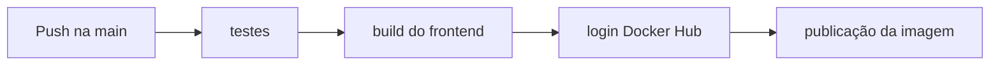

# La Farina

Projeto desenvolvido como solução web para gestão de pedidos de pizzaria, com front-end em Vue 3 e API simulada em JSON Server.

## Demonstração

* Aplicação web: https://hebermacedo.github.io/La-Farina/#/menu
* API: https://api-tpizza-artesanal.onrender.com

## Tecnologias

* Vue 3
* Vue Router
* JSON Server
* Docker
* GitHub Actions

## Como executar localmente

```bash
npm install
npm run bancojson
npm run serve
```

A API fica em `http://localhost:3000` e a aplicação em `http://localhost:8080` quando usada com Docker.

## Docker

```bash
docker compose up -d --build
```

Para limpar o volume local:

```bash
docker compose down -v
```

## Estrutura do projeto

```markdown
├── public/
│   ├── img/               # Recursos visuais (Banner, Logo Circular e Ícones)
│   └── index.html         # Template HTML principal injetado pelo Webpack
├── src/
│   ├── components/        # Componentes reutilizáveis (NavBar, Banner, Alerta, Pedido)
│   ├── views/             # Telas principais mapeadas pelas rotas da aplicação
│   ├── router/            # Configurações de navegação SPA (Single Page Application)
│   ├── App.vue            # Componente raiz da aplicação
│   └── main.js            # Inicialização e montagem do ecossistema Vue
├── vue.config.js          # Configurações globais de compilação do Vue CLI
└── package.json           # Dependências e scripts de automação do projeto
```

## Sobre o Projeto

### Objetivo da solução
O projeto é uma solução web para gestão de pedidos de pizzaria, com foco em oferecer uma experiência de compra e acompanhamento de pedidos em tempo real. A interface em Vue 3 consulta e atualiza um banco de dados REST simulado em JSON Server, mantendo as operações de menu, cadastro, login, pedidos e acompanhamento em um fluxo de uso simples e direto.

### Escopo
O sistema atual cobre:
- consulta do cardápio e tipos de pizza;
- cadastro e autenticação de usuários;
- criação, listagem, atualização e remoção de pedidos;
- painel administrativo para acompanhamento do status dos pedidos;
- validação client-side antes do envio de pedido e cadastro.

O sistema não pretende ser um backend completo de produção com autenticação em JWT, banco relacional, filas de processamento ou observabilidade avançada. O escopo principal é demonstrar o fluxo do negócio de pizzaria em uma aplicação front-end conectada a uma API de mock/rest.

### Tipos de teste aplicados
- Teste de API/integração com Jest + Supertest: validam status HTTP e corpo das respostas dos endpoints da API em um banco temporário, sem alterar o banco real do projeto.
- Validação client-side: confirma campos obrigatórios e blocos de navegação no front-end antes do envio.
- Build de front-end: `npm run build` garante que o Vue compila corretamente.

### Pipeline de entrega



## Cenários para teste

| Item | Descrição |
|---|---|
| **Caso de Uso** | UC1 - Realizar pedido de pizza |
| **Finalidade** | Permitir que o cliente escolha um item do cardápio, personalize o pedido e envie a solicitação para o sistema de produção. |
| **Atores** | Cliente, Sistema |
| **Pré-condições** | O cliente acessou a tela de menu e a API da pizzaria está disponível. |
| **Fluxo Principal** | 1- **Sistema** carrega o menu com as opções de pizzas disponíveis. <br> 2- **Cliente** seleciona a pizza, tamanho, borda e acompanhamentos desejados. <br> 3- **Cliente** preenche os dados obrigatórios, como nome e informações do pedido. <br> 4- **Sistema** valida os campos e confirma que os dados estão completos. <br> 5- **Cliente** envia o pedido. <br> 6- **Sistema** registra a solicitação e a exibe no painel de monitoramento. |
| **Fluxos Alternativos** | FA1 - Campos obrigatórios vazios [Passo 4 do Fluxo Principal]. <br> 1- **Sistema** exibe mensagem de alerta destacando os campos faltantes. <br> 2- **Sistema** mantém a tela aberta para correção. <br> FA2 - API indisponível [Passo 5 do Fluxo Principal]. <br> 1- **Sistema** exibe mensagem de erro técnico. <br> 2- **Sistema** informa que o pedido não foi enviado no momento. <br> FA3 - Item indisponível [Passo 2 do Fluxo Principal]. <br> 1- **Sistema** informa que a opção selecionada não está disponível no momento. <br> 2- **Cliente** deve escolher outra opção. |
| **Pós-condições** | Pedido registrado com sucesso no sistema e disponível para acompanhamento. |
| **Regras de negócio** | O nome do cliente é obrigatório. O tamanho da pizza deve ser informado. O sistema não deve permitir envio com campos críticos vazios. A escolha de borda e acompanhamento é opcional, mas deve seguir a regra de customização do cardápio. |
| **Dados Manipulados** | Nome do cliente, sabor da pizza, tamanho, borda recheada, acompanhamento, observações adicionais, status do pedido e valor total. |

| Item | Descrição |
|---|---|
| **Caso de Uso** | UC2 - Acompanhar pedidos em tempo real |
| **Finalidade** | Permitir que o administrador visualize, monitore e atualize o status dos pedidos em tempo real. |
| **Atores** | Administrador, Sistema |
| **Pré-condições** | Há pelo menos um pedido registrado no sistema e o usuário tem acesso ao painel administrativo. |
| **Fluxo Principal** | 1- **Sistema** exibe a lista de pedidos ativos em tempo real. <br> 2- **Administrador** visualiza informações como cliente, pizza, tamanho e status atual. <br> 3- **Administrador** atualiza o status do pedido conforme o andamento da produção. <br> 4- **Sistema** recalcula e re-renderiza a interface automaticamente sem recarregar a página. |
| **Fluxos Alternativos** | FA1 - Pedido removido [Passo 2 do Fluxo Principal]. <br> 1- **Sistema** retira automaticamente o pedido da lista visual. <br> 2- **Administrador** continua a acompanhar os demais itens. <br> FA2 - Falha de sincronização [Passo 4 do Fluxo Principal]. <br> 1- **Sistema** exibe mensagem de aviso de atualização. <br> 2- **Administrador** tenta novamente ou aguarda a reconexão. <br> FA3 - Pedido já concluído [Passo 3 do Fluxo Principal]. <br> 1- **Sistema** bloqueia alteração de status para itens finalizados. |
| **Pós-condições** | Painel de monitoramento atualizado com as modificações mais recentes. |
| **Regras de negócio** | O sistema deve listar os pedidos ativos em ordem de chegada ou prioridade. Alterações no status devem refletir imediatamente na interface. Não é permitido alterar itens que já foram finalizados sem autorização. |
| **Dados Manipulados** | Código do pedido, nome do cliente, item solicitado, status atual, horário do pedido e valor associado. |

| Item | Descrição |
|---|---|
| **Caso de Uso** | UC3 - Cancelar ou remover pedido |
| **Finalidade** | Permitir ao usuário ou administrador remover um pedido que não deve mais continuar na fila de produção. |
| **Atores** | Cliente, Administrador, Sistema |
| **Pré-condições** | O pedido foi registrado previamente e está visível na interface. |
| **Fluxo Principal** | 1- **Usuário** identifica o pedido na lista de acompanhamento. <br> 2- **Usuário** clica no botão de remoção/ação de exclusão. <br> 3- **Sistema** valida se o pedido pode ser removido. <br> 4- **Sistema** exclui o pedido da lista e exibe notificação de aviso. |
| **Fluxos Alternativos** | FA1 - Pedido já em fase final [Passo 3 do Fluxo Principal]. <br> 1- **Sistema** bloqueia a remoção e informa que o pedido não pode ser cancelado. <br> 2- **Usuário** confirma a situação e retorna à tela. <br> FA2 - Confirmação negada [Passo 2 do Fluxo Principal]. <br> 1- **Usuário** cancela a operação. <br> 2- **Sistema** mantém o pedido na fila. <br> FA3 - Falha técnica na exclusão [Passo 4 do Fluxo Principal]. <br> 1- **Sistema** exibe mensagem de erro. <br> 2- **Sistema** mantém o registro e solicita nova tentativa. |
| **Pós-condições** | Pedido removido da fila de produção e da interface do painel. |
| **Regras de negócio** | A remoção deve ser exibida como ação de alerta. O sistema deve garantir que apenas pedidos válidos sejam removidos. A exclusão deve refletir imediatamente na tela de acompanhamento. |
| **Dados Manipulados** | Identificador do pedido, status atual, cliente associado e motivo da remoção quando informado. |

## Cenários de Teste da API

> Observação: os cenários abaixo representam o contrato de validação implementado para a API do projeto. A aplicação já valida campos obrigatórios e retorna respostas consistentes para erros de cliente e falhas simuladas em ambiente de teste.

### Fluxos de sucesso

| ID | Cenário | Endpoint | Método | Dados enviados | Status esperado | Resposta esperada |
|---|---|---|---|---|---|---|
| API-01 | Listar cardápio | `/menu` | `GET` | Nenhum | `200` | `{ "promocoes": [...], "pizzas": [{ "id": 1, "nome": "Pizza Meio-a-Meio", "foto": "...", "descricao": "...", "valor": 0, "eh_novidade": true }] }` |
| API-02 | Listar tamanhos disponíveis | `/tamanhos` | `GET` | Nenhum | `200` | `[{ "id": 1, "descricao": "Pequena - 4 fatias", "valor": 30 }, { "id": 2, "descricao": "Media - 6 fatias", "valor": 40 }]` |
| API-03 | Listar opcionais do pedido | `/opcionais` | `GET` | Nenhum | `200` | `{ "sabores": [{ "id": 1, "nome": "Calabresa Artesanal", "valor": 0 }], "bordas": [{ "id": 1, "nome": "Borda de Catupiry", "valor": 8 }], "bebidas": [{ "id": 1, "nome": "Refrigerante Cola 2L", "valor": 12 }] }` |
| API-04 | Listar status da fila | `/status_pedido` | `GET` | Nenhum | `200` | `[{ "id": 1, "descricao": "Pedido recebido" }, { "id": 2, "descricao": "Em preparo" }, { "id": 5, "descricao": "Pedido pendente" }]` |
| API-05 | Verificar se e-mail já existe | `/usuarios?email=marina%40teste.com` | `GET` | `email` via query string | `200` | `[{ "id": 2, "nome": "Marina Souza", "email": "marina@teste.com", "tipo": "usuario" }]` ou `[]` quando não existe |
| API-06 | Criar usuário com sucesso | `/usuarios` | `POST` | `{ "nome": "Ana", "email": "ana@teste.com", "senha": "123456", "tipo": "usuario", "criadoEm": "2026-10-31T12:00:00.000Z" }` | `201` | `{ "id": 4, "nome": "Ana", "email": "ana@teste.com", "senha": "123456", "tipo": "usuario", "criadoEm": "2026-10-31T12:00:00.000Z" }` |
| API-07 | Listar todos os pedidos | `/pedidos` | `GET` | Nenhum | `200` | `[{ "id": 1, "usuarioId": 2, "nome": "Marina", "pizza": { "id": 1, "nome": "Pizza Meio-a-Meio" }, "tamanho": { "id": 2, "descricao": "Media - 6 fatias", "valor": 40 }, "statusId": 5, "total": 42, "dataPedido": "..." }]` |
| API-08 | Listar pedidos do usuário | `/pedidos?usuarioId=2` | `GET` | `usuarioId` via query string | `200` | `[{ "id": 1, "usuarioId": 2, "nome": "Marina", "statusId": 5, "total": 42 }]` |
| API-09 | Buscar pedido por ID | `/pedidos/1` | `GET` | `id` na rota | `200` | `{ "id": 1, "usuarioId": 2, "nome": "Marina", "pizza": { "id": 1, "nome": "Pizza Meio-a-Meio" }, "tamanho": { "id": 2, "descricao": "Media - 6 fatias", "valor": 40 }, "statusId": 5, "total": 42 }` |
| API-10 | Criar pedido com sucesso | `/pedidos` | `POST` | `{ "usuarioId": 2, "nome": "Marina", "pizza": { "id": 1, "nome": "Pizza Meio-a-Meio" }, "tamanho": { "id": 2, "descricao": "Media - 6 fatias", "valor": 40 }, "statusId": 5, "taxaEntrega": 8, "total": 48, "observacao": "Sem cebola", "dataPedido": "2026-10-31T12:00:00.000Z", "atualizadoEm": "2026-10-31T12:00:00.000Z" }` | `201` | `{ "id": 15, "usuarioId": 2, "nome": "Marina", "pizza": { "id": 1, "nome": "Pizza Meio-a-Meio" }, "tamanho": { "id": 2, "descricao": "Media - 6 fatias", "valor": 40 }, "statusId": 5, "taxaEntrega": 8, "total": 48, "observacao": "Sem cebola", "dataPedido": "2026-10-31T12:00:00.000Z", "atualizadoEm": "2026-10-31T12:00:00.000Z" }` |
| API-11 | Atualizar status do pedido | `/pedidos/1` | `PATCH` | `{ "statusId": 2, "atualizadoEm": "2026-10-31T12:05:00.000Z" }` | `200` | `{ "id": 1, "usuarioId": 2, "nome": "Marina", "statusId": 2, "atualizadoEm": "2026-10-31T12:05:00.000Z" }` |
| API-12 | Excluir pedido | `/pedidos/1` | `DELETE` | Nenhum body | `200` | `{}` |

### Fluxos de erro

| ID | Cenário | Endpoint | Método | Dados enviados | Status esperado | Resposta esperada |
|---|---|---|---|---|---|---|
| API-13 | Pedido sem nome | `/pedidos` | `POST` | `{ "pizza": { "id": 1 }, "tamanho": { "id": 2 }, "statusId": 5 }` | `400` | `{ "erro": "Nome do cliente é obrigatório." }` |
| API-14 | Pedido sem tamanho | `/pedidos` | `POST` | `{ "nome": "Marina", "pizza": { "id": 1 }, "statusId": 5 }` | `400` | `{ "erro": "Tamanho da pizza é obrigatório." }` |
| API-15 | Usuário sem e-mail ou senha | `/usuarios` | `POST` | `{ "nome": "Ana" }` | `400` | `{ "erro": "E-mail e senha são obrigatórios." }` |
| API-16 | Usuário com e-mail inválido | `/usuarios` | `POST` | `{ "nome": "Ana", "email": "ana", "senha": "123456" }` | `400` | `{ "erro": "E-mail inválido." }` |
| API-17 | PATCH com body inválido | `/pedidos/1` | `PATCH` | `{}` ou `{ "statusId": "x" }` | `400` | `{ "erro": "Dados inválidos para atualização." }` |
| API-18 | Pedido inexistente | `/pedidos/999` | `GET` | `id` na rota | `404` | `{ "erro": "Pedido não encontrado." }` |
| API-19 | Falha interna simulada em teste | `/pedidos` ou qualquer rota | `POST`/`GET` | Header `X-Simulate-Error: true` com `NODE_ENV=test` | `500` | `{ "erro": "Erro interno do servidor" }` (sem stack trace) |

### Observações de implementação

- A API retorna `400` quando o nome do cliente ou o tamanho da pizza não são informados, conforme os cenários `API-13` e `API-14`.
- A API retorna `404` quando o pedido solicitado não existe, como no cenário `API-18`.
- A API retorna `500` apenas quando a falha interna é simulada com o header `X-Simulate-Error: true` em conjunto com `NODE_ENV=test`, como ocorre no cenário controlado do `npm test`.
- Esse cenário não é acionado em produção ou no Docker local, porque a variável de ambiente não é definida como `test`.
- As respostas de erro mantêm o formato padronizado e não expõem stack trace ao cliente.

## Como executar os testes

```bash
npm install
npm test
```

A suíte de testes usa `Jest + Supertest` para validar status e corpo das respostas da API em um banco temporário copiado de `db/db.json`, sem alterar o banco real do projeto.

## Docker Hub

A imagem publicada no workflow do CI usa o nome `la-farina`, conforme o arquivo `.github/workflows/ci.yml`.

Para baixar a imagem publicada no Docker Hub:

```bash
docker pull pxmarco/la-farina:latest
```

Link da imagem no Docker Hub:

https://hub.docker.com/r/pxmarco/la-farina

Para executar a imagem localmente:

```bash
docker run -d -p 8080:80 --name la-farina pxmarco/la-farina:latest
```

A aplicação ficará disponível em `http://localhost:8080`.

## Autoria e Contribuição
Desenvolvido por Maria Clara Bertin Vieira Ferreira, Marco Antonio de Melo Peixoto, Heber Americo Macedo, Thaynara Lima Soares Sousa.
